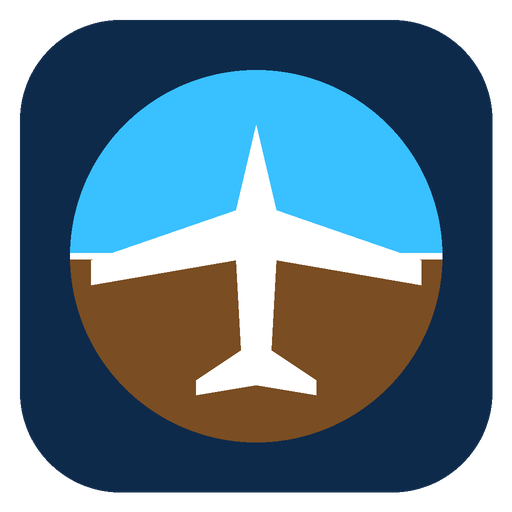

# SkyForge Flight Sim

A free flight simulator for Windows that flies over the real world. It streams satellite imagery and real terrain heights for anywhere on Earth, and it has realistic air and water physics.

## Download

Go to **[Releases](../../releases/latest)** and pick one:

- **SkyForge-Flight-Sim-Setup-1.0.0.exe** installs the game with a Start-menu shortcut. Use this one if you're not sure.
- **SkyForge-Flight-Sim-Portable-1.0.0.exe** runs without installing. Just double-click it.

You need Windows 10 or 11 (64-bit) and an internet connection, because the world map streams in as you fly.

> **"Windows protected your PC"?** The app isn't code-signed yet, so Windows SmartScreen warns about it. Click **More info**, then **Run anyway**.

## What you can fly

- **Cessna 172S Skyhawk**, the classic trainer
- **Extra 330LX**, an aerobatic plane
- **Cessna 208 Caravan Amphibian**, which can land on water or on runways
- **Airbus A320neo**, an airliner with autopilot, spoilers and thrust reversers

Start on any runway in the world by typing its airport code (for example KJFK, EGLL or VHHH), search for any city or landmark, or try the scenic and seaplane starts.

## Quick start

1. Press **Ctrl + .** to release the parking brake.
2. Press **F4** for full power, and steer with **Q** / **E**.
3. At about 55 knots, press **↓** to lift the nose and take off.
4. Steer with the **arrow keys**. **C** changes the camera, and **Esc** opens the menu.

The in-game **Controls** menu lists every key. Joysticks and gamepads work too.

## License

This game is free to download and play for personal use. The source code is private, and copying, modifying or redistributing the game is not allowed. See [LICENSE](LICENSE). Third-party credits are in [THIRD_PARTY_NOTICES.md](THIRD_PARTY_NOTICES.md).
